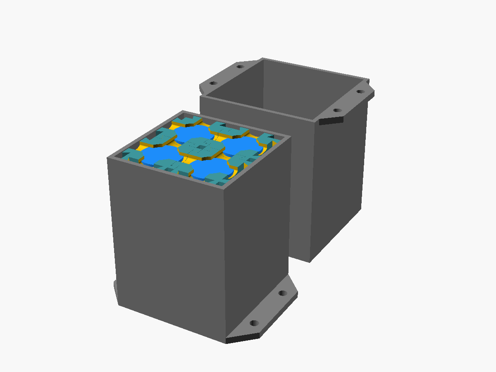
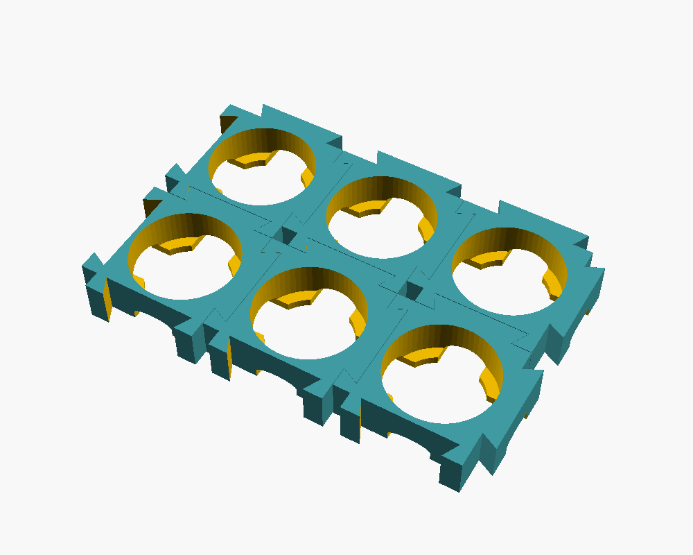

# battpack-scad

Snap-together battery holders for cylindrical cells, designed in OpenSCAD,
with a box and cover to hold the pack. Each holder takes one end of one cell
and has dovetails on two sides and sockets on the other two, so holders slide
together into any grid. A pack is two grids, one on each end of the cells,
joined by nickel strip through slots in the holders' lips.





## Use it

Open `battpack.scad` in [OpenSCAD](https://openscad.org), pick a cell and a
grid, and export each `part`:

- `holder`: print `cells_x × cells_y × 2` of them, lip side up;
- `box` and `cover`: the cover slides over the box and rests on its flanges,
  so one screw through each pair of holes mounts both;
- `grid` and `assembly` are for looking at.

| Parameter | Default | Description |
| --- | --- | --- |
| `cell` | `"18650"` | AAA, AA, C, D, CR123A, 18650, 21700 or 26650, from `cells.scad`. |
| `diameter`, `length` | 0 | Your cell's size in mm, overriding the listed one. Real cells vary: measure yours. |
| `cells_x`, `cells_y` | 2, 2 | Grid size. |
| `holder_height` | 6 | Depth of each holder's bore. |
| `wall_thickness` | 2 | A holder's block is the cell diameter plus this. |
| `connector_depth` | 3 | Depth of the dovetails. |
| `retainer_thickness` | 1.4 | Thickness of the lip under the cell. |
| `retainer_radius`, `wire_cut` | 0 | How far the lip reaches under the cell, and the strip slot width. 0 uses diameter / 10 and (diameter − 2 × reach) / 2. |
| `cell_allowance`, `connector_allowance` | 0.2, 0.2 | Bore diameter over the cell; socket width over the dovetail. |
| `arc_cutout` | true | Arch the slot roofs, so a holder printed lip up needs no support. |
| `tie_slot` | true | Leave a gap at one socket's end for a cable tie. |
| `retainer` | true | `false` leaves the lip out, for an open bore. |
| `flange_width`, `mounting_hole_diameter` | 10, 4 | Mounting flanges, one hole per row of cells. |
| `box_wall_thickness`, `box_floor_thickness` | 2, 3 | |
| `box_allowance` | 0.3 | Clearance around the grid in the box, and between box and cover. |

The console prints the holder pitch and box height:

```
2 x 2 18650 cells; holder pitch 23.4 mm; box 70.9 mm tall
```


`just prints` exports the holder, box and cover STLs for the default 2 × 2
18650 pack into `prints/`.

### In your own model

```openscad
use <battpack-scad/cells.scad>
use <battpack-scad/battery_holder.scad>

battery_holder(diameter = cell_diameter("18650"), height = 6, wall_thickness = 3, retainer_thickness = 2);
```

`battery_holder.scad` also has `batteryHolderConfig()` to lay out a grid,
`battery_holder_box()` for the box and cover, and `holder_pitch()` and
`grid_span()` for their sizes. `examples/minimal.scad` is the snippet above.

## Checks

`just test` takes about 7 s on OpenSCAD 2026.10.15. At four settings (2 × 2
18650, the defaults; 1 × 1 AA; 3 × 2 26650 without the tie slot; 4 × 1
21700 with an open bore) it checks that:

- a holder is one piece of the expected size, and a grid is separate holders
  spanning `grid_span()`;
- a cell drops into the bore clear of it and the lip stops it, or with no lip
  passes through;
- neighbouring holders don't touch, and their dovetails lock: they meet
  within 0.3 mm pulled apart, 0.2 mm pushed together and 0.1 mm sideways;
- the pack stands in the box clear of it, and no looser than
  `box_allowance`;
- the cover seats on the box clear of it and of the pack, and its flanges
  rest on the box's with the holes lined up;
- the box and cover are one piece each, of the expected size.

`just images` renders the pictures.

## Licence

MIT; see [LICENSE](LICENSE).
